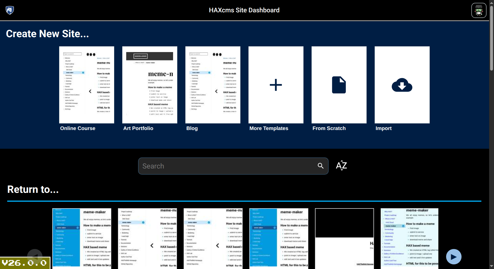

[](https://www.repostatus.org/#active)
[](https://securityscorecards.dev/viewer/?uri=github.com/haxtheweb/haxcms-nodejs)
[](/SUPPORT.md)
[](https://opensource.org/licenses/Apache-2.0)
[](/CODE_OF_CONDUCT.md)
[](https://discord.gg/aCGxmRHEJP)
[](https://lit.dev/)
[![#HAXTheWeb](https://img.shields.io/badge/-HAXTheWeb-999999FF?style=flat&logo=data:image/svg%2bxml;base64,PHN2ZyBpZD0iZmVhMTExZTAtMjEwZC00Y2QwLWJhMWQtZGZmOTQyODc0Njg1IiBkYXRhLW5hbWU9IkxheWVyIDEiIHhtbG5zPSJodHRwOi8vd3d3LnczLm9yZy8yMDAwL3N2ZyIgdmlld0JveD0iMCAwIDE4NC40IDEzNS45NyI+PGRlZnM+PHN0eWxlPi5lMWJjMjAyNS0xODAwLTRkYzItODc4NS1jNDZlZDEwM2Y0OTJ7ZmlsbDojMjMxZjIwO308L3N0eWxlPjwvZGVmcz48cGF0aCBjbGFzcz0iZTFiYzIwMjUtMTgwMC00ZGMyLTg3ODUtYzQ2ZWQxMDNmNDkyIiBkPSJNNzguMDcsODMuNDVWNTVIODYuMnY4LjEzaDE2LjI2djQuMDdoNC4wN1Y4My40NUg5OC40VjY3LjE5SDg2LjJWODMuNDVaIi8+PHBvbHlnb24gcG9pbnRzPSIxNTMuMTMgNjMuNyAxNTMuMTMgNTEuMzkgMTQwLjU0IDUxLjM5IDE0MC41NCAzOS4wOSAxMjcuOTUgMzkuMDkgMTI3Ljk1IDI2Ljc5IDEwMi43OCAyNi43OSAxMDIuNzggMzkuMDkgMTE1LjM2IDM5LjA5IDExNS4zNiA1MS4zOSAxMjcuOTUgNTEuMzkgMTI3Ljk1IDYzLjcgMTQwLjU0IDYzLjcgMTQwLjU0IDc2IDEyNy4zNiA3NiAxMjcuMzYgODguMyAxMTQuNzggODguMyAxMTQuNzggMTAwLjYxIDEwMi4xOSAxMDAuNjEgMTAyLjE5IDExMi45MSAxMjcuMzYgMTEyLjkxIDEyNy4zNiAxMDAuNjEgMTM5Ljk1IDEwMC42MSAxMzkuOTUgODguMyAxNTIuNTQgODguMyAxNTIuNTQgNzYgMTY1LjcyIDc2IDE2NS43MiA2My43IDE1My4xMyA2My43Ii8+PHBvbHlnb24gcG9pbnRzPSIzMy4xMyA2My43IDMzLjEzIDUxLjM5IDQ1LjcyIDUxLjM5IDQ1LjcyIDM5LjA5IDU4LjMxIDM5LjA5IDU4LjMxIDI2Ljc5IDgzLjQ4IDI2Ljc5IDgzLjQ4IDM5LjA5IDcwLjg5IDM5LjA5IDcwLjg5IDUxLjM5IDU4LjMxIDUxLjM5IDU4LjMxIDYzLjcgNDUuNzIgNjMuNyA0NS43MiA3NiA1OC44OSA3NiA1OC44OSA4OC4zIDcxLjQ4IDg4LjMgNzEuNDggMTAwLjYxIDg0LjA3IDEwMC42MSA4NC4wNyAxMTIuOTEgNTguODkgMTEyLjkxIDU4Ljg5IDEwMC42MSA0Ni4zMSAxMDAuNjEgNDYuMzEgODguMyAzMy43MiA4OC4zIDMzLjcyIDc2IDIwLjU0IDc2IDIwLjU0IDYzLjcgMzMuMTMgNjMuNyIvPjwvc3ZnPg==)](https://haxtheweb.org/)
[](https://www.npmjs.com/package/@haxtheweb/haxcms-nodejs)
[](https://github.com/haxtheweb/haxcms-nodejs/actions)
[](https://twitter.com/intent/follow?screen_name=haxtheweb)
[](https://codespaces.new/haxtheweb/haxcms-nodejs)

# HAXcms with nodejs backend
Start the server in any HAXsite or HAXcms instance

## Onboarding

New to the HAX ecosystem? **[Start here](https://github.com/haxtheweb/issues/blob/master/CONTRIBUTING.md)** — the single onboarding guide covers prerequisites, cloning the core repos, installing, and running each project locally.

## Who HAXcms is for

- **Faculty, instructors, and course designers** — author course sites, OER materials, and microsites in the browser with HAX, then publish them anywhere.
- **Instructional designers and content teams** — build accessible, standards-based pages out of web components, with no build tooling to maintain.
- **Campus IT and system administrators** — a self-hosted, database-free Node.js backend: flat files, git-backed publishing, an OpenAPI-documented, JWT-authenticated v1 REST API (conformance-tested), and configuration-driven deployment profiles.
- **Students and learners** — consume fast, offline-capable, WCAG-aligned static sites on any device.
- **Desktop and CLI users** — this backend is the engine wrapped by the HAX desktop app and driven by the `hax` CLI.



## Run commands
```bash
npm install
npm start
```

Visit http://localhost:3000 if it doesn't automatically open

### No-login mode (`npx @haxtheweb/haxcms-nodejs`, `npm run dev:nologin`)
The `haxcms-nodejs` bin (`src/local.js`) sets `HAXCMS_DISABLE_JWT_CHECKS`, which
turns **every** authentication check off. In this mode the server binds to
`127.0.0.1` only, so it is reachable from this machine and nowhere else. It is
not meant for LAN/remote access; use the normal (login) mode for that. If you
really must expose it, set `HAXCMS_HOST` (for example `0.0.0.0`): the server
then prints a loud security warning, because anyone who can reach the address
gets full superuser access. `HAXCMS_DISABLE_JWT_CHECKS` is always ignored when
`NODE_ENV=production`.

## Environment variables
| Variable | Purpose |
| --- | --- |
| `PORT` | Port to listen on (default `3000`; the next free port is tried if busy). |
| `HAXCMS_HOST` | Interface to bind. Default: all interfaces in login mode, `127.0.0.1` in no-login mode. A non-loopback value in no-login mode prints a security warning. |
| `HAXCMS_DISABLE_JWT_CHECKS` | Local no-login mode (set by the `haxcms-nodejs` bin). Disables authentication; ignored when `NODE_ENV=production`. |
| `HAXCMS_ROOT` | Root directory holding `_sites`, `_published` and friends (default: current directory). |
| `HAXCMS_ENABLE_SSL` | Serve HTTPS with locally generated certificates (mkcert, falling back to openssl). |
| `HAXCMS_SSL_KEY` / `HAXCMS_SSL_CERT` / `HAXCMS_SSL_CA` | Paths to your own TLS key, certificate and optional CA bundle (takes priority over `HAXCMS_ENABLE_SSL`). |
| `HAXCMS_RUNTIME_USERNAME` / `HAXCMS_RUNTIME_PASSWORD` | Override the admin username/password at runtime without editing `.user` (for example from Docker secrets or host env vars). |
| `HAXCMS_ALLOW_DEFAULT_CREDS` | Emergency override that lets the server start even when known default credentials are detected. Do not use in production. |
| `NODE_ENV` | `production` disables development-only behaviour, including no-login mode. |

### First-run admin password
On first start, if no `.user` file exists in the config directory, HAXcms creates
an `admin` account with a random password. When stderr is an interactive
terminal the password is printed there. Otherwise (Docker, systemd, CI) it is
written to `INITIAL_ADMIN_PASSWORD.txt` (mode `0600`) in the config directory
and only that path is logged, so the secret never ends up in log aggregation.
Read it, log in, change the password, then delete the file. Alternatively,
supply `HAXCMS_RUNTIME_USERNAME` / `HAXCMS_RUNTIME_PASSWORD`.

### Docker
The image runs as the non-root `node` user and declares two volumes. Mount both
so data and keys survive container recreation:
```bash
docker run -p 3000:3000 \
  -v haxcms-sites:/app/_sites \
  -v haxcms-config:/home/node/.haxcmsconfig \
  haxcms-nodejs
```
`/home/node/.haxcmsconfig` holds the JWT signing keys, password salt, admin
account, `userData.json` and `apiKeys.json`. To read the first-run password:
`docker exec <container> cat /home/node/.haxcmsconfig/INITIAL_ADMIN_PASSWORD.txt`.
## API conformance testing
Run endpoint conformance checks against `src/openapi/site-spec.yaml`:
```bash
npm run test:api-conformance
```

The runner creates an isolated runtime workspace, then bootstraps a real site via API before endpoint checks run.
- The first bootstrap step calls `createSite` and generates a runtime site name:
  - `haxcms-test-harness-{timestampStartOfTest}`
- All conformance calls then run against that real site path.
- Optional runtime login override values:
  - `HAXCMS_TEST_USERNAME`
  - `HAXCMS_TEST_PASSWORD`

Runtime credential overrides are also supported in-process via globals:
- `globalThis.HAXCMS_RUNTIME_CREDENTIALS = { username, password }`
- `globalThis.HAXCMS_RUNTIME_USERNAME`
- `globalThis.HAXCMS_RUNTIME_PASSWORD`

When no `globalThis` override is set, the same `HAXCMS_RUNTIME_USERNAME` /
`HAXCMS_RUNTIME_PASSWORD` values are also read from `process.env`, so they can
be supplied as plain environment variables (e.g. Replit Secrets, Docker/host
env vars) instead of JS globals. `globalThis` values always take precedence
over the environment when both are present.

### Current coverage snapshot
Current automated test coverage in this repository is the API conformance suite:
- Suite file: `test/api-conformance/site-spec.conformance.test.cjs`
- Script: `npm run test:api-conformance`
- Additional test scripts/suites are not currently wired in `package.json`

The suite currently validates:
- Discovery/spec endpoints:
  - `getSiteApiDiscovery`, `getSiteOpenApi`, `getSiteOpenApiJson`, `getSiteOpenApiYaml`, `getApiCatalog`
- Site/content graph endpoints:
  - `getSiteSummary`, `listEntityDescriptors`, `listSchemas`, `listItems`, `getItemByIdOrSlug`, `listContent`, `getContentByIdOrSlug`, `listTags`, `searchContent`
- Component and metadata endpoints:
  - `listCustomElements`, `getCustomElementByName`, `listBlocks`, `getBlockByName`, `getBlockUsage`, `listRegions`, `getRegionByName`
- Theme/report/view/analytics endpoints:
  - `listThemes`, `getActiveTheme`, `getThemeByName`, `listReports`, `getReportByName`, `getAnalyticsCapabilities`, `listViews`, `getViewById`, `getViewResults`, `listDisplaysAlias`, `getDisplayResultsAlias`
- Secured file and revision endpoints:
  - `listFiles`, `createFile`, `getFileByUuid`, `updateFileByUuid`, `deleteFileByUuid`, `listItemRevisions`

Behavior coverage in the same suite includes:
- OpenAPI response/schema conformance checks
- Auth matrix checks for secured routes (no auth, bearer-only, invalid site token, valid site token)
- Boundary/error checks (missing required params, invalid ids/slugs, pagination/query bounds)
- Representation/header checks (`json`, `yaml`, `xml`, `md`, `html` where supported)
- End-to-end file lifecycle checks (create → list/find → get → update → delete)

Temporary known skip in the suite:
- `getApiCatalog returns linkset payload`
  - Reason: runtime `/.well-known/api-catalog` fixture behavior is still being finalized
## MCP and deployment profiles
- MCP policy defaults are controlled via `_config/config.json`.
- New installs include:
  - `deploymentProfile`: `single-site`, `self-hosted-multi-site`, or `haxiam-managed`
  - `mcp.enabled`: global MCP toggle
  - `mcp.readOnly`: write-protection toggle for future MCP write tools
- Default behavior:
  - `haxiam-managed` defaults MCP to disabled unless explicitly enabled.
  - Other profiles default to MCP enabled with read-only mode on.

# Get Help / Issues / Support
- Discord Channel - https://discord.gg/aCGxmRHEJP
- Unified issue queue - https://github.com/haxtheweb/issues/issues
- Using Merlin directly in any HAX spaces and type "Issue" to jump start a report!

## Watch and Learn more about HAX here:
- Try Hax: https://hax.cloud
- HAXCellence https://haxtheweb.org/what-is-hax
- Youtube channel - https://www.youtube.com/@haxtheweb

# Related links and tech
- [NPM Package list](https://www.npmjs.com/org/haxtheweb)
- [HAXcms (NodeJS)](https://github.com/haxtheweb/haxcms-nodejs)
- [HAXcms (PHP)](https://github.com/haxtheweb/haxcms-php)
- [Storybook docs](https://open-apis.hax.cloud/)
- [HAX [dot] PSU](https://hax.psu.edu)
- [HAX doc site](https://haxtheweb.org/)
- [HAX + 11ty](https://github.com/haxtheweb/hax11ty)


